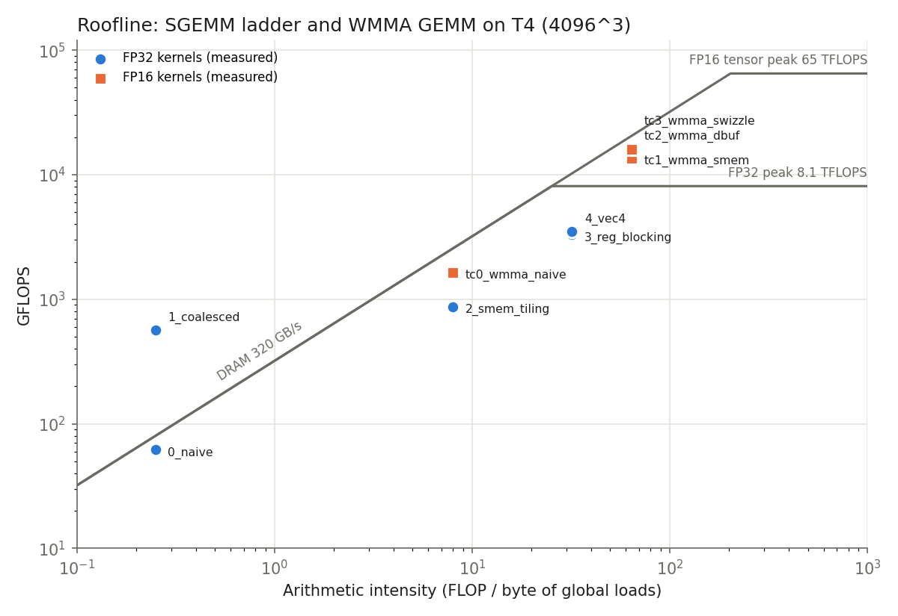

# cuda-dl-kernels

Optimizing deep learning operators in CUDA on an NVIDIA T4 (Turing, sm_75):

- **FP32 SGEMM** optimization ladder: naive -> coalescing -> shared-memory tiling -> 2D register blocking -> float4 vectorization, vs cuBLAS.
- **FP16 tensor-core GEMM** with WMMA: naive -> shared-memory tiled -> double-buffered (software-pipelined) -> swizzled block order, vs cuBLAS FP16.
- **Fused softmax**: single global pass with warp-shuffle block reductions, vs a naive 3-kernel version and torch.softmax.
- **PyTorch C++/CUDA extension** exposing all kernels, with correctness tests against torch.
- **Analytical performance model + roofline** predicting each kernel's ceiling from its tiling, compared with measurements.
- **Occupancy report** (registers, shared memory, blocks/SM per kernel) and an **end-to-end GPT-2 inference profile** with torch.profiler.

## Layout

```
src/common.cuh           error checks, CUDA-event timing (median), init, verification
src/kernels.cuh          FP32 SGEMM stages 0-4 + cuBLAS FP32 baseline
src/kernels_wmma.cuh     FP16 WMMA GEMMs TC0-TC3 + cuBLAS FP16 baseline
src/kernels_softmax.cuh  naive 3-kernel and fused softmax
src/{sgemm,hgemm,softmax}.cu   C++ benchmark harnesses -> results/*.csv
src/occupancy.cu         registers / smem / blocks per SM / occupancy per kernel
ext/ops_cuda.cu, ext/ops.cpp   PyTorch extension (dlk.sgemm / dlk.hgemm / dlk.softmax)
python/test_ops.py       correctness vs torch.matmul / torch.softmax
python/bench_torch.py    timing vs torch -> results/torch_compare.csv
python/roofline.py       performance model + roofline -> results/perf_model.csv, roofline.png
python/profile_gpt2.py   GPT-2 inference GPU-time breakdown + softmax at attention shapes
cuda_dl_kernels_kaggle.ipynb   runs everything on Kaggle (GPU T4 x2)
```

## Run

```
make ARCH=sm_75
./sgemm 1024 2048 4096 && ./hgemm 1024 2048 4096 && ./softmax && ./occupancy
pip install ninja && python python/test_ops.py && python python/bench_torch.py && python python/roofline.py && python python/profile_gpt2.py
```

## Kernels

| Stage | Idea | Expected bottleneck after it |
|---|---|---|
| 0 naive | 1 thread per output, threadIdx.x along rows | uncoalesced global loads |
| 1 coalesced | threadIdx.x along columns: 128B lines, A broadcast | global bandwidth / latency |
| 2 smem tiling | 32x32 tiles in shared memory, global traffic / 32 | 2 shared loads per FMA |
| 3 register blocking | 128x128 block tile, 8x8 outputs per thread in registers | shared-memory bank conflicts, instruction count |
| 4 vec4 | float4 global loads/stores, transposed A tile for float4 shared reads | latency (no double buffering) |
| TC0 naive WMMA | 1 warp per 16x16 C tile, fragments from global | global traffic |
| TC1 smem WMMA | 128x128 block tile, 64x32 per warp (4x2 fragments), padded smem | load latency between k-steps |
| TC2 double-buffered | prefetch tile k+1 into registers during MMAs on tile k | occupancy (150 regs/thread -> 1 block/SM) |
| TC3 swizzled | TC1 with grouped block order so resident blocks share A/B panels in L2 | - |
| softmax fused | row in registers, warp-shuffle max/sum, 1 read + 1 write | DRAM bandwidth (target) |

## Results (Tesla T4, Kaggle, CUDA 12.8)

All 49 correctness tests pass (`python/test_ops.py`). Times are the median of 10 runs. T4 clocks vary run to run (70 W power cap), so compare kernels within one run.

### FP32 SGEMM, 4096^3

| Kernel | GFLOPS | % of cuBLAS | Speedup vs naive |
|---|---|---|---|
| 0_naive | 62 | 1.5% | 1x |
| 1_coalesced | 565 | 14% | 9.1x |
| 2_smem_tiling | 870 | 22% | 14x |
| 3_reg_blocking | 3,294 | 82% | 53x |
| 4_vec4 | 3,510 | 87% | 57x |
| cuBLAS | 4,036 | 100% | |

Through the PyTorch extension: vec4 3.50 TFLOPS vs torch.matmul 3.92 TFLOPS (89%).

### FP16 tensor-core GEMM (WMMA, FP32 accumulate)

| Kernel | 2048^3 TFLOPS | % of cuBLAS | 4096^3 TFLOPS | % of cuBLAS |
|---|---|---|---|---|
| tc0_wmma_naive | 2.5 | 6% | 1.6 | 5% |
| tc1_wmma_smem | 22.0 | 55% | 13.6 | 41% |
| tc2_wmma_dbuf | 22.9 | 57% | 16.1 | 49% |
| tc3_wmma_swizzle | **28.3** | **71%** | 16.0 | 48% |
| cuBLAS FP16 | 40.0 | 100% | 33.0 | 100% |

### Softmax (FP32, ~8M elements; GB/s = read x once + write y once)

| Shape | naive 3-kernel | fused | fused vs naive | torch.softmax* | ours fused* |
|---|---|---|---|---|---|
| 16384 x 512 | 91 GB/s | 245 GB/s | 2.69x | 213 GB/s | 237 GB/s |
| 8192 x 1024 | 128 GB/s | 239 GB/s | 1.87x | 209 GB/s | 232 GB/s |
| 4096 x 2048 | 120 GB/s | 235 GB/s | 1.96x | 207 GB/s | 220 GB/s |
| 2048 x 4096 | 120 GB/s | 229 GB/s | 1.91x | 228 GB/s | 216 GB/s |
| 24576 x 1024 (GPT-2 attention scores) | | | | 207 GB/s | 229 GB/s |

\* measured side by side through the PyTorch extension (`bench_torch.py`, `profile_gpt2.py`), so torch and ours share the same timing path.

### Occupancy (`./occupancy`, from the CUDA runtime)

| Kernel | Threads | Regs/thread | Smem/block | Blocks/SM | Occupancy | Limiter |
|---|---|---|---|---|---|---|
| 2_smem_tiling | 1024 | 42 | 8 KB | 1 | 100% | threads |
| 3_reg_blocking | 256 | 127 | 8 KB | 2 | 50% | registers |
| 4_vec4 | 256 | 101 | 8 KB | 2 | 50% | registers |
| tc1_wmma_smem | 256 | 122 | 18.5 KB | 2 | 50% | registers |
| tc2_wmma_dbuf | 256 | 150 | 37 KB | 1 | 25% | registers |
| softmax_fused | 256 | 23-37 | 32 B | 4 | 100% | threads |

No kernel spills registers to local memory.

### GPT-2 (124M) FP16 inference, batch 8 x 1024 tokens (`torch.profiler`)

| GPU time share | eager attention | fused attention (SDPA) |
|---|---|---|
| GEMM | 49.6% | 59.9% |
| elementwise (GELU, masking, scaling, adds) | 40.8% | 29.8% |
| softmax | 8.2% | - |
| fused attention kernel | - | 8.1% |
| layernorm | 1.4% | 2.2% |
| **time per forward pass** | **271 ms** | **178 ms** |



## Findings

- **Coalescing (9x)** is the biggest single step: the naive kernel's warp touches 32 different cache lines per load.
- **Shared-memory tiling alone gains little (1.5x)**: with 2 shared loads per FMA it becomes shared-memory-bandwidth bound. **Register blocking** (8x8 outputs per thread, 16 shared loads feed 64 FMAs) unlocks 3.8x on top of it, at the cost of 127 registers/thread (occupancy 50%), which is fine because each thread now has 64 independent FMAs to hide latency.
- **Above-roofline points** (1_coalesced): the no-reuse model counts every load as global traffic; L1/L2 caches actually serve most of them.
- **Double buffering is a trade, not a free win.** It needs 150 registers and 37 KB of shared memory per block, which drops occupancy from 50% to 25% (1 block/SM, register-limited). Across runs its result ranged from slightly worse to 18% better than TC1: the latency it hides is partly offset by fewer resident warps.
- **Thread-block swizzling is the best tensor-core change: +29% at 2048 (22.0 -> 28.3 TFLOPS, 71% of cuBLAS)** with identical code otherwise. Resident blocks share A/B panels in L2 instead of streaming all of B.
- **All our tensor-core kernels still drop at 4096** (28 -> 16 TFLOPS) while cuBLAS holds 33. Swizzling recovers part of it (+17% over TC1); the rest likely needs larger warp tiles, a deeper pipeline, and better L2 blocking. Confirming needs Nsight Compute.
- **Fused softmax** reaches 72-77% of the 320 GB/s peak, beats torch.softmax by up to 11% on 3 of 4 shapes and at GPT-2's attention shape.
- **End to end, GEMMs are half of GPT-2's GPU time, but elementwise ops are 41% in eager mode.** Fused attention (SDPA) removes the separate softmax and most mask/scale kernels and cuts the forward pass from 271 to 178 ms (-34%). Kernel fusion matters as much as GEMM speed.
- Nsight Compute counters are blocked on Kaggle (`ERR_NVGPUCTRPERM`); the occupancy numbers above come from the CUDA occupancy API instead.
